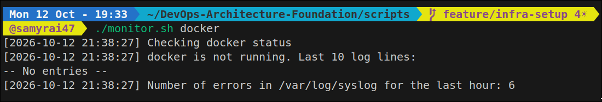
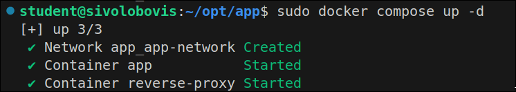
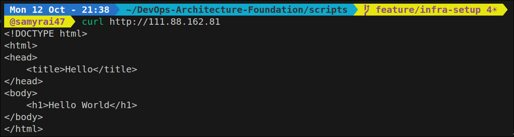
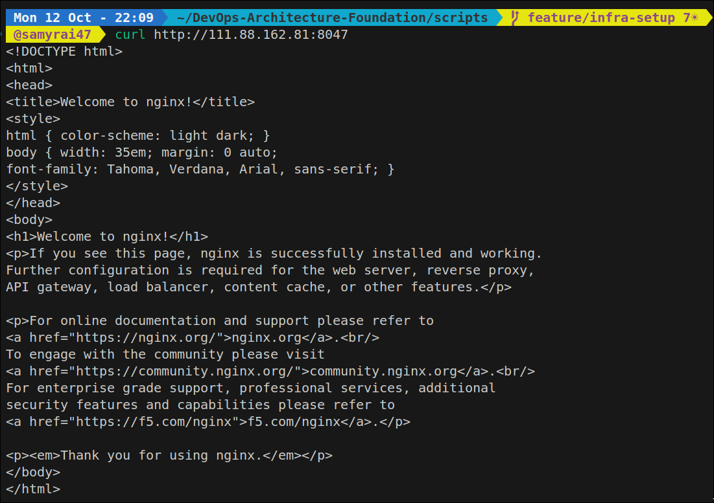

# Инструкция по разворачиванию

## Ansible

Поставить ansible на локальную машину:

```
sudo apt update
sudo apt install ansible
```

Подтянуть файлы с репозитория:

```
git clone https://github.com/Samyrai47/DevOps-Architecture-Foundation.git
```

Перейти в директорию ansible:

```
cd DEVOPS-ARCHITECTURE-FOUNDATION
cd ansible
```

Запустить playbook:

```
ansible-playbook -i inventory.ini setup_host.yml
```

## Terraform

Поставить terraform на локальную машину. Используйте набор команд ниже или [обратитесь к руководству terraform](https://developer.hashicorp.com/terraform/install):

```
wget -O - https://apt.releases.hashicorp.com/gpg | sudo gpg --dearmor -o /usr/share/keyrings/hashicorp-archive-keyring.gpg
echo "deb [arch=$(dpkg --print-architecture) signed-by=/usr/share/keyrings/hashicorp-archive-keyring.gpg] https://apt.releases.hashicorp.com $(grep -oP '(?<=UBUNTU_CODENAME=).*' /etc/os-release || lsb_release -cs) main" | sudo tee /etc/apt/sources.list.d/hashicorp.list
sudo apt update && sudo apt install terraform
```

Подтянуть файлы с репозитория:

```
git clone https://github.com/Samyrai47/DevOps-Architecture-Foundation.git
```

Перейти в директорию terraform:

```
cd DEVOPS-ARCHITECTURE-FOUNDATION
cd terraform
```

Проинициализировать terraform:

```
terraform init
```

Должно появиться сообщение об успешной инициализации:

```
Initializing the backend...

Initializing provider plugins...
- Reusing previous version of kreuzwerker/docker from the dependency lock file
- Using previously-installed kreuzwerker/docker v4.6.0

Terraform has been successfully initialized!

You may now begin working with Terraform. Try running "terraform plan" to see
any changes that are required for your infrastructure. All Terraform commands
should now work.

If you ever set or change modules or backend configuration for Terraform,
rerun this command to reinitialize your working directory. If you forget, other
commands will detect it and remind you to do so if necessary.
```

В случае появления подобной ошибки:

```
Error: Invalid provider registry host
│ 
│ The host "registry.terraform.io" given in provider source address "registry.terraform.io/kreuzwerker/docker"
│ does not offer a Terraform provider registry.
```

попробуйте включить VPN.

Ознакомиться с планом изменений:

```
terraform plan
```

Создать инфраструктуру:

```
transform apply
```

Terraform запросит подтверждение:

```
Do you want to perform these actions?

Enter a value:
```

Ввести:

```
yes
```

Проверить, что контейнер создан и доступен:

```
curl -i http://<VM_IP>:8047
```

Если IP не менялся:

```
curl -i http://111.88.162.81:8047
```

Удалить ресурсы:

```
terraform destroy -auto-approve
```

## monitor.sh

Подтянуть файлы с репозитория:

```
git clone https://github.com/Samyrai47/DevOps-Architecture-Foundation.git
```

Перейти в директорию scripts:

```
cd DEVOPS-ARCHITECTURE-FOUNDATION
cd scripts
```

Дать права на выполнение для файла:

```
sudo chmod +x monitor.sh
```

Применить скрипт:

```
./monitor.sh <service>
```


# Про Ansible

Первый вывод был такой:

```
ansible-playbook -i inventory.ini setup_host.yml

PLAY [Setup host] ************************************************************************************************************************

TASK [Gathering Facts] *******************************************************************************************************************
ok: [vm1]

TASK [user : Create deployer user] *******************************************************************************************************
changed: [vm1]

TASK [user : Allow deployer to have passwordless sudo] ***********************************************************************************
changed: [vm1]

TASK [docker : Update apt cache] *********************************************************************************************************
changed: [vm1]

TASK [docker : Install dependencies for Docker] ******************************************************************************************
ok: [vm1]

TASK [docker : Create Docker GPG key directory] ******************************************************************************************
ok: [vm1]

TASK [docker : Download Docker's official GPG key] ***************************************************************************************
ok: [vm1]

TASK [docker : Add Docker repository to apt] *********************************************************************************************
ok: [vm1]

TASK [docker : Update apt cache after adding Docker repository] **************************************************************************
changed: [vm1]

TASK [docker : Install Docker and Docker Compose] ****************************************************************************************
ok: [vm1]

TASK [docker : Enable and start Docker] **************************************************************************************************
ok: [vm1]

PLAY RECAP *******************************************************************************************************************************
vm1                        : ok=11   changed=4    unreachable=0    failed=0    skipped=0    rescued=0    ignored=0
```

На второй запуск проявилась проблема:

```
ansible-playbook -i inventory.ini setup_host.yml

PLAY [Setup host] ************************************************************************************************************************

TASK [Gathering Facts] *******************************************************************************************************************
ok: [vm1]

TASK [user : Create deployer user] *******************************************************************************************************
ok: [vm1]

TASK [user : Allow deployer to have passwordless sudo] ***********************************************************************************
ok: [vm1]

TASK [docker : Update apt cache] *********************************************************************************************************
changed: [vm1]

TASK [docker : Install dependencies for Docker] ******************************************************************************************
ok: [vm1]

TASK [docker : Create Docker GPG key directory] ******************************************************************************************
ok: [vm1]

TASK [docker : Download Docker's official GPG key] ***************************************************************************************
ok: [vm1]

TASK [docker : Add Docker repository to apt] *********************************************************************************************
ok: [vm1]

TASK [docker : Update apt cache after adding Docker repository] **************************************************************************
changed: [vm1]

TASK [docker : Install Docker and Docker Compose] ****************************************************************************************
ok: [vm1]

TASK [docker : Enable and start Docker] **************************************************************************************************
ok: [vm1]

PLAY RECAP *******************************************************************************************************************************
vm1                        : ok=11   changed=2    unreachable=0    failed=0    skipped=0    rescued=0    ignored=0   
```

Смысл проблемы заключался в том, что я прописал cache_update. Поэтому даже если фактически новые пакеты не подтягивались (или не менялись старые), ansible все равно показывал это как изменение. После того, как я добавил handlers в docker role, и в task поменял cache_update на notify, проблема устранилась:

```
ansible-playbook -i inventory.ini setup_host.yml

PLAY [Setup host] ************************************************************************************************************************

TASK [Gathering Facts] *******************************************************************************************************************
ok: [vm1]

TASK [user : Create deployer user] *******************************************************************************************************
ok: [vm1]

TASK [user : Allow deployer to have passwordless sudo] ***********************************************************************************
ok: [vm1]

TASK [docker : Install dependencies for Docker] ******************************************************************************************
ok: [vm1]

TASK [docker : Create Docker GPG key directory] ******************************************************************************************
ok: [vm1]

TASK [docker : Download Docker's official GPG key] ***************************************************************************************
ok: [vm1]

TASK [docker : Add Docker repository to apt] *********************************************************************************************
ok: [vm1]

TASK [docker : Apply pending handlers] ***************************************************************************************************

TASK [docker : Install Docker and Docker Compose] ****************************************************************************************
ok: [vm1]

TASK [docker : Enable and start Docker] **************************************************************************************************
ok: [vm1]

PLAY RECAP *******************************************************************************************************************************
vm1                        : ok=9    changed=0    unreachable=0    failed=0    skipped=0    rescued=0    ignored=0
```

Далее, уже на этапе terraform, вскрылась проблема с тем, что deployer находился в группе sudo, но не в группе docker, из-за этого от его лица нельзя было выполнить terraform инструкции. Поэтому обновил еще раз user role, добавив deployer в docker группу и пробросив ssh ключ. Далее приведены два последовательных запуска:


```
ansible-playbook -i inventory.ini setup_host.yml

PLAY [Setup host] ************************************************************************************************************************

TASK [Gathering Facts] *******************************************************************************************************************
ok: [vm1]

TASK [user : Create deployer user] *******************************************************************************************************
ok: [vm1]

TASK [user : Allow deployer to have passwordless sudo] ***********************************************************************************
ok: [vm1]

TASK [user : Add SSH key for deployer] ***************************************************************************************************
changed: [vm1]

TASK [docker : Install dependencies for Docker] ******************************************************************************************
ok: [vm1]

TASK [docker : Create Docker GPG key directory] ******************************************************************************************
ok: [vm1]

TASK [docker : Download Docker's official GPG key] ***************************************************************************************
ok: [vm1]

TASK [docker : Add Docker repository to apt] *********************************************************************************************
ok: [vm1]

TASK [docker : Apply pending handlers] ***************************************************************************************************

TASK [docker : Install Docker and Docker Compose] ****************************************************************************************
ok: [vm1]

TASK [docker : Enable and start Docker] **************************************************************************************************
ok: [vm1]

PLAY RECAP *******************************************************************************************************************************
vm1                        : ok=10   changed=1    unreachable=0    failed=0    skipped=0    rescued=0    ignored=0


ansible-playbook -i inventory.ini setup_host.yml

PLAY [Setup host] ************************************************************************************************************************

TASK [Gathering Facts] *******************************************************************************************************************
ok: [vm1]

TASK [user : Create deployer user] *******************************************************************************************************
ok: [vm1]

TASK [user : Allow deployer to have passwordless sudo] ***********************************************************************************
ok: [vm1]

TASK [user : Add SSH key for deployer] ***************************************************************************************************
ok: [vm1]

TASK [docker : Install dependencies for Docker] ******************************************************************************************
ok: [vm1]

TASK [docker : Create Docker GPG key directory] ******************************************************************************************
ok: [vm1]

TASK [docker : Download Docker's official GPG key] ***************************************************************************************
ok: [vm1]

TASK [docker : Add Docker repository to apt] *********************************************************************************************
ok: [vm1]

TASK [docker : Apply pending handlers] ***************************************************************************************************

TASK [docker : Install Docker and Docker Compose] ****************************************************************************************
ok: [vm1]

TASK [docker : Enable and start Docker] **************************************************************************************************
ok: [vm1]

PLAY RECAP *******************************************************************************************************************************
vm1                        : ok=10   changed=0    unreachable=0    failed=0    skipped=0    rescued=0    ignored=0
```

# Про terraform

```
terraform show 
# docker_container.nginx:
resource "docker_container" "nginx" {
    attach                                      = false
    bridge                                      = null
    command                                     = [
        "nginx",
        "-g",
        "daemon off;",
    ]
    container_read_refresh_timeout_milliseconds = 15000
    cpu_set                                     = null
    cpu_shares                                  = 0
    domainname                                  = null
    entrypoint                                  = [
        "/docker-entrypoint.sh",
    ]
    env                                         = []
    hostname                                    = "c3c2bc76417d"
    id                                          = "c3c2bc76417df3326e3cf2dc1bf874fbf8cc9645834a29130f7d39dbf5999444"
    image                                       = "sha256:f9ea18bfa4fad859e1ed38259d711da7ccad2c3516e875cec3351a57c859f571"
    init                                        = false
    ipc_mode                                    = "private"
    log_driver                                  = "json-file"
    logs                                        = false
    max_retry_count                             = 0
    memory                                      = 0
    memory_reservation                          = 0
    memory_swap                                 = 0
    must_run                                    = true
    name                                        = "nginx"
    network_data                                = [
        {
            gateway                   = "172.18.0.1"
            global_ipv6_address       = null
            global_ipv6_prefix_length = 0
            ip_address                = "172.18.0.2"
            ip_prefix_length          = 16
            ipv6_gateway              = null
            mac_address               = "5e:39:b2:d2:d3:28"
            network_name              = "nginx-network"
        },
    ]
    network_mode                                = "bridge"
    platform                                    = "linux"
    privileged                                  = false
    publish_all_ports                           = false
    read_only                                   = false
    remove_volumes                              = true
    restart                                     = "no"
    rm                                          = false
    runtime                                     = "runc"
    security_opts                               = []
    shm_size                                    = 64
    start                                       = true
    stdin_open                                  = false
    stop_signal                                 = "SIGQUIT"
    stop_timeout                                = 0
    tty                                         = false
    user                                        = null
    userns_mode                                 = null
    wait                                        = false
    wait_timeout                                = 60
    working_dir                                 = null

    mounts {
        source = "nginx_volume"
        target = "/usr/share/nginx/html"
        type   = "volume"
    }

    networks_advanced {
        aliases        = []
        driver_opts    = []
        ipv4_address   = null
        ipv6_address   = null
        link_local_ips = []
        mac_address    = null
        name           = "nginx-network"
    }

    ports {
        external = 8047
        internal = 80
        ip       = "0.0.0.0"
        protocol = "tcp"
    }
}

# docker_image.nginx:
resource "docker_image" "nginx" {
    id           = "sha256:f9ea18bfa4fad859e1ed38259d711da7ccad2c3516e875cec3351a57c859f571nginx:latest"
    image_id     = "sha256:f9ea18bfa4fad859e1ed38259d711da7ccad2c3516e875cec3351a57c859f571"
    keep_locally = true
    name         = "nginx:latest"
    repo_digest  = "nginx@sha256:f9ea18bfa4fad859e1ed38259d711da7ccad2c3516e875cec3351a57c859f571"
}

# docker_network.nginx_network:
resource "docker_network" "nginx_network" {
    attachable  = false
    driver      = "bridge"
    id          = "6ab556e005cd25fd57f6af3b215037d6a731a0f679c43ab02a6e587e4330bb35"
    ingress     = false
    internal    = false
    ipam_driver = "default"
    ipv6        = false
    name        = "nginx-network"
    options     = {}
    scope       = "local"

    ipam_config {
        aux_address = {}
        gateway     = "172.18.0.1"
        ip_range    = null
        subnet      = "172.18.0.0/16"
    }
}

# docker_volume.nginx_volume:
resource "docker_volume" "nginx_volume" {
    driver     = "local"
    id         = "nginx_volume"
    mountpoint = "/var/lib/docker/volumes/nginx_volume/_data"
    name       = "nginx_volume"
}
```

# Пример использования monitor.sh:



# Про docker-compose

Писал все папки и файлы на VM, прогнал docker compose up:



На хосте кинул запрос по адресу, получил ожидаемый ответ:



Причем можно заметить, что по порту 8047 (который записан в terraform), поднят другой nginx:



На случай, если интересно посмотреть сам код, загрузил его в данный репозиторий (см. `opt/app`).
